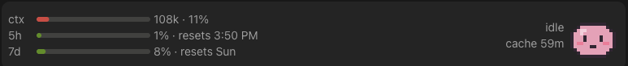

# my-buddy

A Claude Code mod that puts a small pixel-art buddy above the prompt. It acts out what the session and its subagents are doing: reading, searching, editing, running commands, waiting for you, and so on. Next to it, meters show your context use, your 5-hour and 7-day limits, and a countdown of the prompt cache. Mod only, no server.



## Install

```sh
claude plugin marketplace add hungnvo/my-buddy
claude plugin install my-buddy@my-buddy
```

Then run `/reload-plugins` in an open session. If your sessions use the 5-minute prompt cache instead of the 1-hour one, install with `--config cacheTtlMinutes=5`.

To work on a local clone instead, add the marketplace by path: `claude plugin marketplace add ./my-buddy`.

## Commands

- `/buddy` opens the buddy pane.
- `/buddy-demo` cycles the buddy through every state.

## States

<table>
<tr>
<td align="center"><br>idle</td>
<td align="center"><br>thinking</td>
<td align="center"><br>reading</td>
<td align="center"><br>searching</td>
<td align="center"><br>editing</td>
<td align="center"><br>running</td>
<td align="center"><br>browsing</td>
</tr>
<tr>
<td align="center"><br>spawning</td>
<td align="center"><br>waiting</td>
<td align="center"><br>working</td>
<td align="center"><br>error</td>
<td align="center"><br>done</td>
<td align="center"><br>compacting</td>
<td></td>
</tr>
</table>

| State | Trigger |
| --- | --- |
| thinking | a prompt is submitted |
| reading | tool `Read`, `LSP`, `Skill`, or a `Bash` command running `cat`, `head`, `tail`, `sed`, `less`, `more`, `jq`, `wc`, `bat`, `awk`, `sort`, `uniq`, `diff`, `xxd`, `git diff`, `git show`, `git blame` |
| searching | tool `Grep`, `Glob`, `ToolSearch`, or a `Bash` command running `grep`, `egrep`, `rg`, `ag`, `find`, `fd`, `ls`, `tree`, `locate`, `which`, `git status`, `git log`, `git grep`, `git ls-files`, `git branch` |
| editing | tool `Edit`, `Write`, `NotebookEdit` |
| running | tool `Monitor`, or any other `Bash` command (including other `git` subcommands) |
| browsing | tool `WebSearch`, `WebFetch`, an `mcp__` browser tool (browser, chrome, playwright, puppeteer), or a `Bash` command running `curl`, `wget`, `gh`, `http` |
| spawning | tool `Agent`, `Task`, `Workflow` |
| waiting | tool `AskUserQuestion`, or a permission request; also when the main turn ends with a question (the desktop app's `wrap_up` with an `ask`, or a final message ending in `?`), until you reply or the main thread does something else |
| working | any other tool, or a subagent starting; also while background subagents run after the main turn ended (`working on 2 helpers`, instead of idle) |
| error | a tool call returns an error |
| done | the turn completes without a question (back to idle after 5 s) |
| compacting | before a compaction (idle again after it) |
| idle | nothing is happening; the band is hidden unless a subagent is still active or any meter has data |

The desktop app's housekeeping tools (`mcp__ccd_*`, `TodoWrite`, `TaskCreate`, `TaskUpdate`, `TaskList`, `TaskGet`, `TaskOutput`, `TaskStop`) do not change the buddy.

The label next to the buddy says what the main thread is working on: `editing register.tsx`. The detail comes from the tool's input: the file name for `Read`, `Edit`, `Write` and `NotebookEdit`; the program name only for `Bash` (`running make`, never its arguments, so secrets cannot leak; leading `cd <path> &&`, `VAR=value`, `sudo`, `env`, `time`, `nohup` and `exec` are skipped, and a quote, escape or substitution in those, or an odd first word, shows nothing); the quoted pattern for `Grep` (up to 20); the pattern for `Glob` (up to 24); the host for `WebFetch`; the query for `WebSearch` (up to 24); the description for `Agent` and `Task` (up to 28). Whitespace and newlines inside a detail collapse to single spaces. Other tools show no detail. Any state change without a detail (thinking, done, idle, waiting, ...) clears it. The `/buddy` pane shows it too. Subagent buddies keep no detail.

The left of the band stacks up to three meters, one row per meter that has data, in this order:

| Row | Shows | Bar and color |
| --- | --- | --- |
| `ctx` | context tokens and percent of the window, e.g. `42k · 21%` | fill is the percent of the window; color by tokens: green under 50k, yellow under 100k, red under 150k, magenta at 150k and above |
| `5h` | the 5-hour limit, e.g. `34% · resets 3:40 PM` | fill is the percent used; color by percent: green under 70, yellow under 90, red at 90 and above |
| `7d` | the 7-day limit, e.g. `12% · resets Fri` | same as `5h` |

Reset times are local clock times, so they never go stale between turns. The 7-day row shows the weekday (`next Thu` when that is today's weekday), or the clock time when the reset is within 24 hours. In a narrow band (under 60 columns) the `resets` part is dropped, and when the host offers fewer than 3 rows only that many meters show, `ctx` first. The `resets` part is left out when no reset time is known, and the limit rows only appear on a subscription that reports them. On desktop each bar is a small rounded Svg; in the terminal it is 10 block cells with eighth-block resolution, e.g. `5h  ███▍▏▏▏▏▏▏ 34% · resets 3:40 PM`. On an OAuth (claude.ai) login, an empty limits reading (before the first response of a session) never replaces a known one: the last 5h/7d reading that carries a reset time is kept, across sessions, and shown until a new one arrives, so the rows survive an idle stretch and show at once in a new session; a window whose reset time has passed shows 0%. The kept reading is not used on an API-key login or when signed out and is forgotten on logout. The band stays up even when the buddy is idle, as long as any meter has data.

Under the buddy's label (and in the `/buddy` pane) a `cache 4:12` line counts down the prompt cache of the main conversation, which every main-thread API response refreshes: `m:ss` under 10 minutes, `42m` after, yellow under 60 s, red `cache cold` once expired; it is kept per conversation (session id), so it survives a plugin reload and a resume back into the same conversation (a resumed conversation whose cache expired in the meantime may show `cache cold`), and is hidden before the conversation's first response (after a `/clear` or a resume into another conversation, until its first response), after a compaction or `/model` (which start a cold cache), and while a turn runs (a permission prompt mid-turn included), and on the terminal it shares the label row (`label · cache 4:12`) unless the meters take two rows or more. The cache lifetime is the `cacheTtlMinutes` plugin option (default 60, the 1-hour cache; set 5 if your sessions use the 5-minute cache), since the API usage the mod sees does not say which tier was written.

Subagents get their own smaller buddies next to the main one, driven by their own tool calls. A subagent is dropped 5 s after its last turn, or sooner when the main turn ends; one that goes quiet for 10 minutes is dropped too.

## Development

```sh
claude plugin test .
claude plugin validate .
```

Run `/reload-plugins` in a session to pick up changes.
